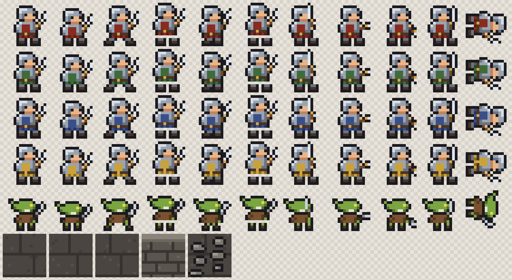

# Art Trial

Rows, top to bottom: hero in four tabard colors (martial, expert, arcane, divine), goblin, then tiles (three floor variants, wall, rubble).
Frames, left to right: idle (2), walk (4), attack (3), hit, down.

## How it's made

The sprites are drawn as text in `packages/web/art/sprites.ts`: one character per pixel, `.` for transparent.
`npm run sprites -w @oathkeepers/web` exports them as PNG sprite sheets plus a manifest, and redraws this preview.

## Swapping in other art (Codex, an asset pack, an artist)

The game only reads `packages/web/public/assets/sprites/`. Replacement art needs:

- One PNG per sheet: `hero-martial.png`, `hero-expert.png`, `hero-arcane.png`, `hero-divine.png`, `goblin.png`, `tiles.png`
- Frames laid out left to right, all the same size (16x16 now; change `frameWidth` and `frameHeight` in `sprites.json` for other sizes)
- Characters facing right
- `sprites.json` listing which frames make each animation: `idle`, `walk`, `attack`, `hit`, `down`
- For `tiles.png`, the `named` entry says which frames are `floor`, `wall` and `rubble`

No code changes are needed as long as the sheet names and animation names stay the same.
